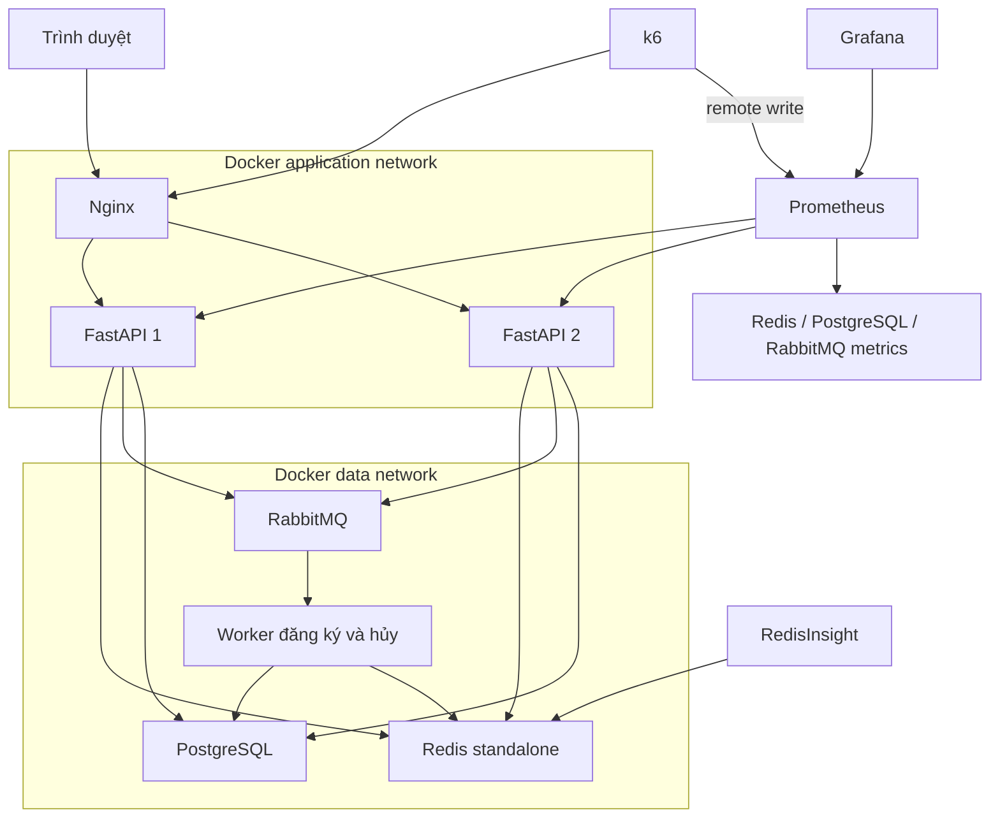

# Thiết kế nâng cấp lab đăng ký học phần và đo tải

Ngày: 2026-11-07. Trạng thái: Dự thảo chờ người dùng duyệt.

## 1. Mục tiêu và phạm vi

Người dùng chọn nâng cấp trực tiếp dự án hiện tại để phục vụ thực hành và trình diễn môn Hạ tầng CNTT. Bộ sản phẩm gồm ứng dụng đăng ký hoạt động đúng, sơ đồ kiến trúc và tuần tự, benchmark PostgreSQL đối chứng với Redis Lua + RabbitMQ, dashboard trực tiếp và hướng dẫn demo có thể lặp lại.

Thành công được đánh giá bằng dữ liệu đo thực tế và tính nhất quán của đăng ký. Không mặc định Redis nhanh hơn PostgreSQL, không điền sẵn số liệu minh họa vào báo cáo kết quả. Không gọi 3.000 requests là 3.000 người dùng đồng thời. Không coi HTTP 202 là đã ghi dữ liệu thành công.

Đây là lab cục bộ trên Windows/Docker Desktop; giữ React, FastAPI, SQLAlchemy, Redis, RabbitMQ, PostgreSQL và hai backend hiện có. Chưa triển khai SSO, hệ thống quản trị đào tạo đầy đủ, Redis Cluster, DB replica, Keepalived, Kubernetes hay hạ tầng cloud. Chưa sản xuất PowerPoint/Word hoặc video; cung cấp nguồn sơ đồ, ảnh xuất nếu công cụ cho phép và runbook quay/demo. Các giả định này là đề xuất của người viết, chưa phải lựa chọn đã được người dùng duyệt.

## 2. Các hướng đã cân nhắc

1. **Nâng cấp dự án hiện tại — người dùng đã chọn.** Dùng chung nghiệp vụ, giao diện và hạ tầng; sửa lỗi trước khi đo. Mất công hơn một mô hình tối giản nhưng kết quả gắn với sản phẩm thật.
2. **Lab benchmark riêng.** Nhanh để trình diễn 60 chỗ nhưng không xác minh ứng dụng hiện có. Không chọn.

## 3. Hiện trạng đã kiểm tra

- Frontend build thành công; 19 tests hiện có pass, nhưng integration tests đang mock Redis/queue/database.
- Worker chỉ tiêu thụ registration_queue; drop_queue chưa có consumer. Frontend tự tạo registration_id khi hủy.
- Polling hết ba lần có thể báo CONFIRMED dù server chưa xác nhận.
- Lua rollback tăng slot vô điều kiện; lịch 84 tiết đang đi qua phép toán bit và số ở nhiều runtime, cần thay biểu diễn để tránh sai số/cắt bit.
- Client gửi tín chỉ, tiên quyết, lịch và student_id; backend chưa lấy hoàn toàn từ nguồn đáng tin cậy.
- Dashboard Grafana có panels nhưng thiếu queries; chưa có /metrics của backend; Redis và RabbitMQ scrape targets chưa đúng.
- Docker Engine chưa truy cập được ở lần kiểm tra gần nhất. Khả năng chạy tải thật sẽ phải kiểm tra lại khi triển khai.

## 4. Kiến trúc lab

Đây là sơ đồ container/network logic, không phải VLAN vật lý hay HA nhiều máy. Viết thêm một sơ đồ production đề xuất riêng, đánh dấu rõ chưa triển khai; không gắn thông số máy chủ hoặc hiệu năng chưa đo vào lab. Sequence diagram phải thể hiện polling, PENDING/CONFIRMED/FAILED, lỗi nghiệp vụ, retry và rollback thực tế. Không mô tả batch insert hoặc SSE khi chưa có.

Compose build frontend bằng multi-stage image để không phụ thuộc dist đã build thủ công. Có healthchecks/readiness, volumes và script PowerShell chạy từ thư mục dự án. Các cổng quản trị bind localhost; database/broker truy cập nội bộ là mặc định. Monitoring profile khởi chạy Prometheus, Grafana, RedisInsight và exporters; k6 chạy theo lệnh riêng. Pin phiên bản image/dependency khi triển khai và ghi lại phiên bản đã kiểm chứng.

## 5. Đúng nghiệp vụ trước khi benchmark

### Danh tính và dữ liệu lớp

- Giữ demo sinh viên mẫu qua chế độ LAB_MODE rõ ràng, không xây trang đăng nhập mật khẩu mới. Lab có chọn sinh viên mẫu và token JWT được sinh mới bằng script để phục vụ UI/k6; giao diện ghi rõ tài khoản demo.
- Ngoài LAB_MODE, không chấp nhận X-Student-Id thay JWT. student_id phải lấy từ JWT; reject yêu cầu ghi đè khác danh tính đã xác thực. Kiểm tra quyền trên danh sách đăng ký, vé và hủy.
- Backend tự lấy học kỳ, tín chỉ, tiên quyết và lịch từ dữ liệu lớp đã seed/cache; request đăng ký chỉ cần section_id và idempotency key. Validate sinh viên tồn tại, học kỳ đang mở, lớp hợp lệ.
- Sửa dữ liệu tiên quyết trong catalog và seed dữ liệu môn đã hoàn thành. Dữ liệu benchmark bảo đảm tất cả 3.000 sinh viên đủ điều kiện cho lớp đích.
- Biểu diễn lịch bằng danh sách chỉ số tiết 0..83 và Redis set; Lua kiểm tra phần tử giao nhau, thêm/xóa các tiết nguyên tử. Không truyền số nguyên 84-bit qua JavaScript number hay Lua number. Chuyển phần đọc/ghi liên quan và thêm test lịch cuối tuần.

### Đăng ký, retry và lỗi hạ tầng

- Lua giữ chỗ và ghi trạng thái PENDING kèm ticket/metadata trong cùng thao tác nguyên tử. Metadata đủ để đối soát hoặc phát lại job sau khi API chết giữa Redis và RabbitMQ.
- Dùng publisher confirms và message bền vững. HTTP 202 trả khi broker đã xác nhận nhận job; nếu publish lỗi/timeout thì giữ trạng thái chưa rõ, trả lỗi có ticket để kiểm tra, không tự giải phóng chỗ khi chưa biết broker nhận hay chưa.
- Có lệnh recovery đối soát PENDING cũ với DB và phát lại job theo ticket. Giới hạn lab: recovery sau sự cố có thể do người vận hành gọi; không tuyên bố exactly-once xuyên Redis/RabbitMQ/PostgreSQL hay tự khôi phục hoàn toàn sau mất dữ liệu Redis.
- Worker ghi DB idempotent, nhận lại cùng ticket không tăng sĩ số lần hai. Chỉ đặt CONFIRMED sau commit; lỗi Redis sau commit không được hiểu là DB thất bại rồi rollback chỗ. Khi trạng thái commit không rõ, kiểm tra DB trước khi quyết định và giữ PENDING nếu DB không truy cập được.
- Retry giới hạn cho lỗi có thể phục hồi; thất bại xác định trước commit mới hoàn trả Redis một lần và chuyển FAILED/DLQ. Recovery không được phát lại ticket terminal FAILED/CANCELLED. Consumer luôn kiểm tra trạng thái terminal/version trước khi tác động.
- Một sinh viên/lớp có một bản ghi trạng thái, cho phép đăng ký lại sau CANCELLED bằng ticket/version mới. Khóa/điều kiện chuyển trạng thái ở DB ngăn tác vụ ticket cũ ghi đè vòng đăng ký mới.
- Idempotency key gắn danh tính, loại thao tác và hash payload; retry cùng key trả lại ticket/kết quả cũ, khác payload bị từ chối. Không fail-open khi Redis mất kết nối.

### Hủy môn

- Frontend dùng registration_id thật. Hủy chỉ áp dụng bản ghi CONFIRMED thuộc sinh viên; chưa cho hủy PENDING trong lab này.
- Thêm consumer drop_queue. Request hủy tạo vé CANCEL_PENDING, chưa trả chỗ ngay. Worker commit CANCELLED và giảm enrolled ở DB đúng một lần, rồi giải phóng Redis đúng một lần; vé chỉ hoàn tất khi cả hai bước xong.
- Xử lý lại job sau crash giữa DB và Redis phải tiếp tục bước còn thiếu, không giảm sĩ số hai lần. Ticket/version cũ không được hủy đăng ký mới. Nếu Redis chưa giải phóng, không cho vòng đăng ký mới vượt qua.
- Lua giải phóng xác nhận đúng ticket sở hữu chỗ trước khi thay đổi sĩ số/tín chỉ/lịch. Hủy lặp, rollback lặp không tăng slot vượt capacity.

## 6. Giao diện

Giữ bố cục danh mục, danh sách đã đăng ký và thời khóa biểu. Ba trạng thái chính: Đăng ký → Đang xử lý → Đã đăng ký. Khóa nút khi request đang chạy, giữ idempotency key khi retry. Chỉ hiển thị thành công khi server xác nhận.

Polling mỗi khoảng một giây với thời gian chờ cấu hình được. Hết thời gian hiển thị “Yêu cầu vẫn đang xử lý”, giữ ticket và cho kiểm tra lại; tải lại trang vẫn lấy được trạng thái từ backend. Lỗi mạng khác FAILED nghiệp vụ. Hủy cũng có trạng thái chờ xác nhận. Không thêm WebSocket/SSE ở đợt này.

Có trang/panel demo gọn: chọn kịch bản, hiển thị trạng thái dữ liệu và link Grafana/RedisInsight. Nút reset chỉ có trong LAB_MODE và cảnh báo phạm vi dữ liệu. Không chạy tải lớn trong request HTTP của frontend; k6 do script điều phối chạy riêng.

## 7. Benchmark đối chứng công bằng

Hai chế độ chạy tuần tự trên cùng stack và dataset lab, chọn bằng cấu hình lúc khởi động, không cho đổi chế độ khi còn tác vụ:

- **postgres:** đăng ký đồng bộ, transaction/row lock bảo vệ sĩ số, kiểm tra cùng nghiệp vụ và cập nhật tín chỉ/lịch dựa trên dữ liệu DB; không dùng Redis/queue trong đường ghi baseline. API trả kết quả đã commit.
- **redis_queue:** Redis Lua giữ chỗ, RabbitMQ/worker ghi DB, trả 202 rồi xác nhận bằng vé.

Tạo học kỳ/lớp benchmark riêng 60 chỗ, 3.000 sinh viên hợp lệ. Script chuẩn bị chỉ reset dữ liệu benchmark, dừng nhận tác vụ benchmark trong lúc reset, chờ hàng đợi ready + unacked và worker in-flight hết; nếu chưa hết thì từ chối reset. Run ID và generation được kiểm tra để job cũ không ghi vào lần chạy mới. Không xóa dữ liệu học phần thường hay volume tự động. Baseline chỉ đọc DB để kiểm chứng, không dùng Redis tồn dư làm nguồn chính xác.

Kịch bản bắt buộc:

1. Smoke nhỏ để kiểm tra cấu hình và metrics trước tải lớn.
2. Flash: 500 VUs × 6 iterations = 3.000 yêu cầu từ 3.000 danh tính khác nhau cho 60 chỗ. Sử dụng iteration index toàn kịch bản để chọn danh tính, không chỉ VU ID.
3. Sustained: tăng dần đến 3.000 VUs, trộn đọc và ghi; thông số chỉnh được theo máy. Không hứa trước laptop chịu được mức này.

Nginx và middleware dùng cùng chính sách ở hai chế độ. Không để tất cả VUs bị gộp vào một IP rate-limit; lab dùng danh tính fixture nhất quán và ghi rõ đây không phải cơ chế chống giả mạo production. Kịch bản đo rate-limit tách riêng. Baseline không chạy middleware idempotency Redis; unique constraint/transaction cung cấp ngữ nghĩa retry phù hợp.

Flash kỳ vọng đúng 60 sinh viên CONFIRMED trong DB, 2.940 SECTION_FULL nếu tất cả request hoàn tất và không lỗi hạ tầng. Mọi 409 đều phải phân loại bằng error_code, không coi duplicate là hết chỗ. HTTP 400/401/429/5xx và timeout ghi riêng. Cấu hình expectedStatuses để 409 hết chỗ không làm méo tỷ lệ lỗi hệ thống.

Báo cáo tách latency nhận phản hồi ban đầu với latency hoàn tất DB, RPS, p95/p99, số accepted/confirmed/failed/pending, lỗi hệ thống, tài nguyên DB/Redis và độ sâu queue. Sau tải, chờ drain có timeout rồi kiểm chứng DB và Redis (đối với redis_queue); hết timeout là kết quả chưa đạt, không bỏ qua. Chạy ít nhất ba lượt đo mỗi chế độ sau warmup, luân phiên thứ tự, lưu từng lượt và median; cùng giới hạn CPU/RAM/pool/worker và bật cùng monitoring. Không thêm sleep giả để làm chậm PostgreSQL.

Xuất summary JSON, CSV/Markdown so sánh và manifest phiên bản/cấu hình máy/run ID. Nếu máy không đủ tài nguyên hoặc Docker chưa chạy, báo blocker và kết quả đã đo ở quy mô thấp hơn, không bịa kết quả 3.000 VUs.

## 8. Giám sát có nguồn dữ liệu thật

- Backend /metrics: request count, duration histogram theo route template/method/status, kết quả nghiệp vụ; không gắn student_id/ticket làm label.
- Worker: metrics endpoint riêng cho thời gian xử lý, retry, hoàn tất/thất bại. Dùng nguồn đo phù hợp cho end-to-end latency; không trộn với request latency.
- Redis exporter, PostgreSQL exporter, RabbitMQ Prometheus plugin; scrape endpoint HTTP metrics đúng, không scrape cổng Redis 6379 hay management 15672.
- k6 gửi remote write vào Prometheus. Datasource và dashboard Grafana được provision tự động; không phụ thuộc import dashboard cộng đồng thủ công.
- Dashboard bốn nhóm: (1) RPS, latency, mã phản hồi; (2) CPU/RAM/network; (3) queue ready/unacked, worker retry/throughput; (4) Redis memory/connections, DB connections/transactions và kết quả benchmark.
- CPU/RAM/network container: ưu tiên cAdvisor nếu hoạt động trên Docker Desktop của máy; nếu không, một collector lab đọc Docker stats từ host PowerShell rồi xuất textfile metrics cho exporter. Không đưa Docker socket vào ứng dụng. Ghi rõ chu kỳ lấy mẫu và nguồn container/host; không suy luận băng thông từ RPS.
- Scrape khoảng 2–5 giây cho demo, thời gian refresh dashboard tương ứng. CPU được hiển thị đúng đơn vị và giới hạn container; dữ liệu thiếu hiện “không có dữ liệu”, không thay bằng 0.
- RedisInsight kết nối Redis riêng; kiểm chứng trực tiếp keys và SQL tương ứng schema thật (registrations, course_sections), không dùng bảng enrollments giả định.

## 9. Tài liệu trình diễn

Nguồn Mermaid cho network lab, kiến trúc production đề xuất và sequence đăng ký/hủy; hướng dẫn import/xuất SVG vào Draw.io. Sơ đồ phải đi cùng mã hiện thực. Có register.lua rút gọn dùng trên slide, ghi rõ đây là minh họa, không thay Lua nghiệp vụ đầy đủ.

Runbook PowerShell gồm build/start/seed/smoke/benchmark/check/stop, các URL và truy vấn kiểm chứng. Demo 90 giây dùng flash test đã chuẩn bị dữ liệu trước; màn hình bốn góc Grafana, docker stats, RedisInsight/SQL, k6. Cung cấp checklist quay video dự phòng; chỉ ghi video nếu người dùng yêu cầu và môi trường hỗ trợ.

Peak shaving minh họa 4 ca, ghi rõ dữ liệu mô phỏng và giả định phân bố đều. Không tuyên bố tiết kiệm 60% chi phí nếu chưa có mô hình chi phí. Chưa thực thi lịch mở cổng theo khoa trong ứng dụng; đó là phương án nghiệp vụ trong tài liệu.

## 10. Kiểm chứng và tiêu chí bàn giao

- Unit tests cho điều kiện nghiệp vụ và chuyển trạng thái; integration thật với Redis/PostgreSQL/RabbitMQ cho giữ chỗ đồng thời, cuối tuần, lặp request/hủy, đăng ký lại, job cũ, publisher lỗi, worker redelivery và phục hồi lỗi sau commit.
- Test danh tính/ownership, client sửa tín chỉ/tiên quyết, ticket người khác và demo endpoints khi LAB_MODE tắt.
- Frontend typecheck/build; kiểm tra luồng trình duyệt thành công/thất bại/pending kéo dài/hủy/refresh.
- Compose config hợp lệ, readiness thành công, scrape targets UP, dashboard hiển thị dữ liệu thật khi smoke chạy.
- Flash kết quả đúng 60 CONFIRMED và 0 slot với redis_queue, DB đúng 60 với baseline; kiểm tra enrolled và tín chỉ khớp, không chỉ đếm HTTP 202.
- Bàn giao mã, cấu hình, sơ đồ, runbook và artifacts đo thực tế. Những kiểm tra chưa chạy phải được ghi rõ.

## 11. Quyết định để người triển khai xử lý

Người triển khai chọn thư viện metrics, phiên bản image đã kiểm chứng, tên file/module, cấu trúc tests và cách tổ chức recovery phù hợp mã hiện có. Không thay stack, thêm cloud hoặc mở rộng thành hệ thống quản trị đào tạo. Nếu cần đổi ngữ nghĩa dữ liệu hay mở rộng phạm vi đáng kể, cập nhật thiết kế trước.

Lịch trình công việc dự kiến: đúng nghiệp vụ → môi trường chạy được → benchmark đối chứng → monitoring → sơ đồ/runbook → đo và kiểm chứng tổng thể. Đây là thứ tự thiết kế, chưa phải kế hoạch triển khai chi tiết.

## Nguồn kỹ thuật tham chiếu

- Redis Lua API: https://redis.io/docs/latest/develop/programmability/lua-api/
- k6 Prometheus remote write: https://grafana.com/docs/k6/latest/results-output/real-time/prometheus-remote-write/
- k6 API (expectedStatuses): https://grafana.com/docs/k6/latest/javascript-api/
- RabbitMQ monitoring (metrics port 15692): https://www.rabbitmq.com/docs/monitoring
